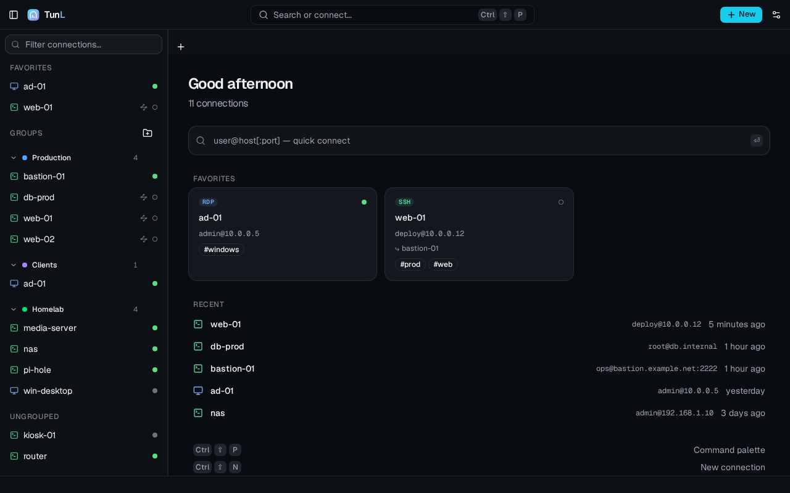
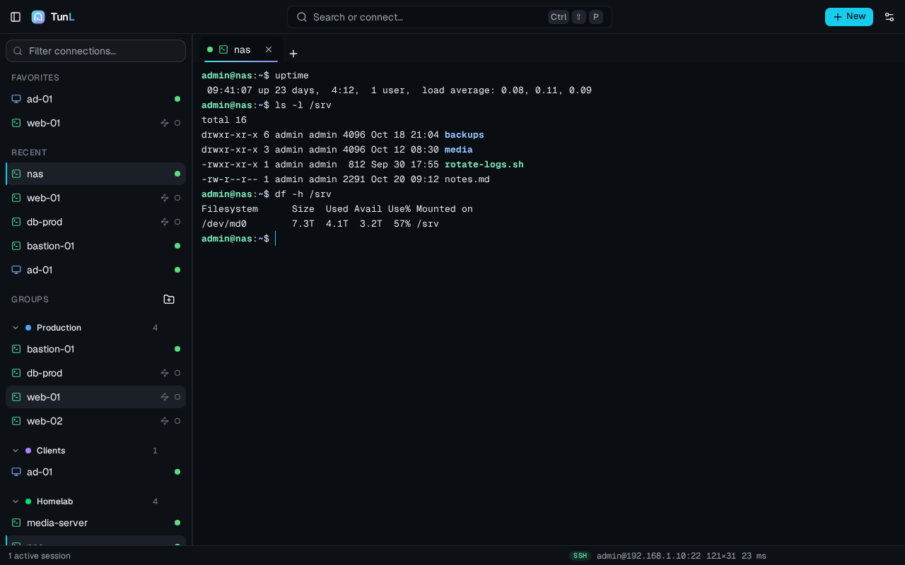

<p align="center"></p>

<h1 align="center">TunL</h1>

<p align="center">SSH, SFTP and RDP connections for Linux — one window, keyboard first, secrets in your keyring.</p>



## Features

- **SSH terminal in tabs** (xterm.js): password, private key with passphrase, SSH agent, keyboard-interactive
  (two-factor). Search, links, copy and paste, zoom.
- **Host keys checked** like OpenSSH (`~/.ssh/known_hosts` is read, never changed): a first connection shows the
  fingerprint, a changed key is refused with an explanation.
- **Jump hosts**: chain up to four saved SSH connections; SSH, SFTP and RDP all go through them.
- **SFTP explorer**: browse, create, rename, delete, permissions, downloads and uploads with progress, drag and drop
  from the desktop.
- **RDP** through FreeRDP 3 in its own window, with the credentials passed on its standard input, never on its
  command line; behind a jump host too.
- **Wake-on-LAN**, before connecting or on demand, and **reachability dots** for every connection.
- **Organisation**: groups, tags, favorites, recents, instant filter, command palette (`Ctrl+Shift+P`), quick
  connect (`user@host:port`), import of `~/.ssh/config`, export and import of your connections as a JSON file.
- **Private**: passwords and passphrases live in the system keyring (Secret Service: KWallet, GNOME Keyring…). No
  account, no telemetry, no update check: TunL only connects where you ask it to.
- English and French; light, dark or system theme; reduced motion.



## Install

On Fedora 43 and 44, install from [Copr](https://copr.fedorainfracloud.org/coprs/strelok/tunl/) to get updates with
the rest of the system:

```bash
sudo dnf copr enable strelok/tunl
sudo dnf install tunl
```

Packages for each release are on the [releases page](https://github.com/Fleorens/TunL/releases): a `.deb` (Debian 13,
Ubuntu 24.04 and later), an `.rpm` (Fedora) and an AppImage (any recent distribution). Check them against
`SHA256SUMS`, published beside them.

```bash
sudo apt install ./tunl_*_amd64.deb      # Debian, Ubuntu
sudo dnf install ./tunl-*.x86_64.rpm     # Fedora
chmod +x tunl_*_amd64.AppImage && ./tunl_*_amd64.AppImage
```

You can also build a Flatpak for immutable distros (Silverblue, Kinoite, SteamOS…) and Flathub: it builds offline from
the two files in `packaging/flatpak/` (regenerate them with `npm run flatpak:sources` after a lockfile changes), with
`flatpak-builder --user --install --force-clean build packaging/flatpak/io.github.fleorens.TunL.yml`, needing the GNOME 51
runtime and the `rust-stable`, `node22` Flathub extensions.

What TunL relies on, beside the package's own dependencies (WebKitGTK 4.1):
- a **Secret Service** keyring (KWallet on Plasma, GNOME Keyring elsewhere) to remember passwords;
- **FreeRDP 3** for RDP: `freerdp3-sdl` (Debian, Ubuntu), `freerdp` (Fedora, Arch). TunL tells you when it is
  missing, with the command for your distribution.

## Troubleshooting

- **A blank or white window** (some NVIDIA drivers): start TunL with `WEBKIT_DISABLE_DMABUF_RENDERER=1 tunl`.
- **Passwords are asked every time**: no Secret Service keyring is running; TunL still works, but cannot remember.
- **Where are my files?** `~/.config/io.github.fleorens.TunL/` (connections, settings, TunL's own `known_hosts`),
  `~/.local/share/io.github.fleorens.TunL/logs/` (logs, never a secret). Settings › About opens both.

## Where it stands

| Works today | Not yet |
|---|---|
| Connections: create, edit, duplicate, delete, favorites, groups, filter | |
| Home screen: greeting, quick-connect field, favorites grid, recents list, first-launch welcome (T14) | |
| Editor: SSH / RDP, authentication method, jump host chain, Wake-on-LAN, RDP display options | |
| `~/.ssh/config` import: preview, select hosts, choose a group, apply (T15, T15b) | |
| Command palette (Ctrl+Shift+P / Ctrl+K): search connections, quick connect, toggle theme, keyboard shortcuts (F1) | |
| Secrets: passwords and SSH key passphrases in the system keyring, saved/replaced/forgotten in the connection editor (T12) | |
| Storage: `~/.config/io.github.fleorens.TunL/connections.json` (mode 0600, `.bak` copy) | |
| SSH sessions in tabs: terminal, connecting steps, error card with Retry, end banner with Reconnect, through a chain of jump hosts (T21, T22) | |
| Connection prompts: host key, password/passphrase (keyring), 2FA, changed host key (T21b) | |
| Availability dots: TCP probes, sidebar and home, latency in the status bar (T30) | |
| Wake-on-LAN: send the magic packet from the connection menu, and wake a host before connecting (T29) | |
| SFTP tab: browse a server's folders (breadcrumb, typed path, sortable virtualized table, hidden files, keyboard) (T25) | |
| SFTP actions: new folder, rename in place (F2), delete with the item count (Del), permissions, copy the path (T25b) | |
| SFTP downloads: double-click or menu, transfers panel with progress, cancel, show in folder (T26d) | |
| SFTP uploads: Upload files (several at once) and drag-and-drop from the desktop, beside an existing name (T26b) | |
| RDP tab: FreeRDP in its own window, session card with duration, translated end reason, filtered log, relaunch, install help when the client is missing (T28b) | |
| RDP through a bastion: a stable tunnel port and the real host name so FreeRDP re-checks the certificate it trusted (T28c) | |
| Settings tab: appearance, terminal (applied live), SSH defaults and known-hosts list, SFTP download folder, FreeRDP client (program detection, manual choice), availability probes, about with the config and log folders, export/import connections as JSON (no secrets) (T31, T31b, T32) | |
| Connecting card: a tunnel animates around the protocol icon while connecting, a check draws itself as each step finishes, and « Reduce animations » (settings or system) stops every animation (T33) | |
| Desktop integration: brand icon, `tunl` package, desktop entry (Network menu) and AppStream metainfo with screenshots (T36) | |
| Packaging without the devbox: a CI runs the whole recipe, both audits and the packaging checks on every push to main and pull request; a `vX.Y.Z` tag builds the deb, rpm and AppImage and attaches them with SHA-256 sums to a draft release (T37) | |
| Flatpak for immutable distros and Flathub: an offline build, every crate and npm package declared in `packaging/flatpak/`, FreeRDP 3 compiled in the sandbox (T38) | |
| Fedora repository on Copr (`strelok/tunl`): an RPM rebuilt offline from vendored crates and npm packages (T41) | |
| Optional TunL title bar (Settings › Appearance): window buttons in the top bar, system bar by default or forced with `TUNL_TITLEBAR=native` (T35) | |

The progress of each task is in [`tasks/README.md`](tasks/README.md).

## Build from source

Prerequisites: Node.js ≥ 22.12, Rust (rustup, with `rustfmt` and `clippy`), WebKitGTK 4.1 and OpenSSL headers.
Details and per-distribution packages: [`docs/07-dev.md`](docs/07-dev.md) §1.

```bash
npm install
npm run tauri dev     # the real app, with the Rust backend (first build: a few minutes)
npm run dev           # the interface only, in a browser at http://localhost:1420, on demo data
npm run tauri build   # the .deb, .rpm and AppImage packages, in src-tauri/target/release/bundle/
```

`npm run dev` answers every backend call with an in-memory mock (the status bar says “Mock backend”): handy to look
at the interface, but only `npm run tauri dev` proves that the app works.

### Check everything

```bash
npm run review
```

It runs, in order: TypeScript, Biome, the project rules (`scripts/project-rules.mjs`) and the contract tests of every
delivered task, Vitest, `cargo fmt` / `clippy` / `test` (including every Tauri command driven through the real IPC
layer), three disposable SSH servers with podman and the SSH integration tests against them, then the Playwright
end-to-end scenarios. The CI runs the same on every pull request. Every script: [`docs/07-dev.md`](docs/07-dev.md).

### Layout

| Path | Content |
|---|---|
| `src/` | React interface: `features/` by domain, `components/`, `lib/` (IPC, mock, errors), `bindings/` (generated from Rust) |
| `src-tauri/` | Rust backend: `commands/` (Tauri commands), `ssh/`, `sftp/`, `rdp/`, `store/`, `model/` |
| `e2e/` | Playwright scenarios; `support/` holds the console guard and the generic UI checks |
| `docs/` | Architecture, decisions, design system, screens, data model, security, dev environment (in French) |
| `tasks/` | One sheet per task, written in lots ([`tasks/README.md`](tasks/README.md): the plan and its progress) |
| `packaging/`, `branding/` | Desktop entry, AppStream metadata, the app icon |
| `scripts/` | Project rules, contract tests, test servers, screenshots, packaging checks |

## How it is built

The code is written task by task by a local model (opencode), from contract sheets in `tasks/`: types, expected
behaviour, pitfalls and tests. Its standing rules are in [`AGENTS.md`](AGENTS.md). An orchestrator (Claude) writes
the architecture and the sheets, then reviews each lot.

## Contributing

Bug reports, ideas and pull requests are welcome: see [`CONTRIBUTING.md`](CONTRIBUTING.md). Security issues: please
report them privately (see the same file). Changes between versions: [`CHANGELOG.md`](CHANGELOG.md).

## License

TunL is free software, under the [GNU General Public License v3.0 or later](LICENSE).
